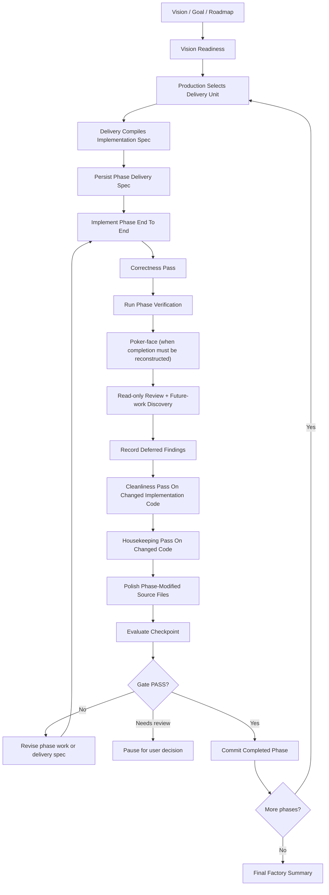

# Loop

Use this reference when the top-level `factory` skill has already selected a delivery-sized unit and you need the detailed execution model.

## Operating Model

Factory runs an iterative implementation loop over a phase set produced by [$production](production.md) and compiled by [$delivery](../../delivery/SKILL.md).

It does not flatten unrelated phases into one mega-plan. It should preserve real phase boundaries and only make the next phase executable after the previous phase has been delivered, checked, and committed. It should also avoid artificial long-tail phase slicing: once the implementation pattern is known, execute the remaining homogeneous work as a coherent batch unless a named split boundary requires separation.



The lens order in the diagram is the same sequence stated in [factory's phase loop](../SKILL.md#phase-loop); change it there first.

## Autonomy And Compaction

Factory should assume it may outlive the current conversational context.

To stay resumable:

- keep a compact factory ledger in chat updates or a repo artifact when the run is long
- record the current phase, completed phases, pending phases, delivery specs, verification commands, deferred findings, and commit hashes
- include enough phase state in updates that a compacted continuation can resume without rediscovering everything
- prefer durable repo artifacts over chat-only plans
- after every phase commit, state the next selected phase or the reason for pausing

## Before Starting

Establish the selected delivery-sized unit and destination surface.

Required inputs:

- the execution-ready goal boundary from [$vision](vision.md)
- the current production ledger and selected delivery-sized unit from [$production](production.md)
- the target repository or execution environment
- the artifact location for phase delivery specs
- the intended checkpoint after each phase

If the selected unit is not bounded enough to compile into implementation work, return to production and split it before continuing.

If the user has not supplied an artifact location, choose a repo-local docs path that matches existing conventions when one is obvious. Otherwise ask a short confirmation question before writing.

## Factory Intake

Build a lightweight factory ledger before running the first phase.

Default ledger fields:

- `Vision Source`
- `Vision Readiness`
- `Production Ledger`
- `Delivery Spec Directory`
- `Target Repo`
- `Current Delivery Unit`
- `Current Phase`
- `Completed Phases`
- `Pending Phases`
- `Checkpoint Policy`
- `Commit Policy`
- `Agent Policy`
- `Correctness Policy`
- `Review And Future-work Policy`
- `Cleanliness Policy`
- `Housekeeping Policy`
- `Polish Policy`
- `Deferred Findings / Future Work`
- `Granularity Policy`
- `Release Checkpoint Policy`
- `Open Questions`

The ledger can live inside the chat while work is active, but durable phase delivery specs must be written to files.

## Phase Selection

Work one phase at a time.

Select the next phase using this priority:

1. explicit user instruction
2. selected delivery-sized unit from production
3. first incomplete phase in the compiled delivery spec
4. next dependency-unblocked phase in the stage graph
5. largest coherent batch that can produce a meaningful checkpoint without crossing a concrete split boundary

Do not skip around the production ledger unless the user asks or a dependency requires it.

Before handing the phase to delivery, make the phase boundary explicit:

- `Phase Name`
- `Phase Goal`
- `Delivery Unit`
- `Inputs`
- `Expected Outputs`
- `Out Of Scope`
- `Checkpoint Target`

## Phase Granularity

Prefer batched, coherent phases.

Factory phases should be large enough that the lifecycle is worth running and small enough that correctness, verification, review, and rollback remain honest. The default is not the smallest possible slice. The default is the largest coherent batch that can pass one meaningful checkpoint.

Default granularity rules:

- choose the largest related phase that still produces a durable, useful outcome
- keep the blast radius small enough that failed work can be revised without unwinding unrelated decisions
- after one implementation pattern is proven, apply it across the remaining homogeneous requirements in the same phase
- split phases when they mix independent subsystems, migrations, public contracts, UI flows, or deployment concerns
- keep a phase intact when splitting it would destroy the acceptance criteria or force artificial handoffs
- prefer a few substantial, reviewable commits over a long series of process-heavy micro-commits
- make rollback and rework cost part of phase selection

Long-tail slicing is a failure mode. Do not create many near-duplicate phases for remaining requirements that share the same implementation pattern, validation path, and ownership boundary. If the next proposed phase would be mostly delivery-spec text, checkpoint narration, polish/closeout reporting, and only a small implementation delta, batch it with adjacent related work.

Warning signs that a phase is too large:

- it needs several unrelated checkpoint targets
- it changes multiple ownership boundaries at once
- it requires broad speculative refactoring before any user-visible or testable result
- it cannot be explained as one coherent outcome
- a failed correctness pass would make it hard to identify the responsible change

Warning signs that a phase is too small:

- it applies an already-established pattern to one file, one variant, one command, one fixture, or one doc section while many equivalent items remain
- it has the same validation command and acceptance shape as adjacent pending work
- its delivery spec, review, cleanliness, housekeeping, polish, checkpoint, and commit overhead dominate the implementation
- completing it would leave a queue of near-identical follow-up phases
- the remaining related work can reasonably finish in the same implementation cycle

When a phase looks too large, revise the phase set before invoking delivery. Delivery should receive a bounded phase, not a whole-program bundle disguised as one stage.

When a phase looks too small, revise the phase set before invoking delivery. Merge it with adjacent homogeneous requirements until the next checkpoint is a substantial completed slice.

## Delivery Handoff

Invoke [$delivery](../../delivery/SKILL.md) for the selected delivery-sized unit.

The handoff should ask delivery for implementation-sized work, not a whole-program factory plan.

The delivery artifact must include:

- interpreted phase problem
- normalized phase spec
- repo-aware phase baseline
- phase stage graph
- phase workstreams or issues
- phase checkpoint and gate plan
- open questions blocking that phase

Save the artifact before implementation begins.

Recommended file naming:

- `docs/<project>-phase-<n>-delivery.md`
- `docs/<project>-stage-<n>-delivery.md`
- `docs/<project>-<phase-name>-delivery.md`

Use the naming convention already present in the repository when one exists.

## Implementation Loop

After the delivery spec is saved, implement the selected phase completely.

Factory owns execution, not just planning.

For each phase:

- inspect the live repo state and current diff
- follow the phase delivery spec
- use agents deliberately to preserve factory context and isolate bounded work
- keep edits scoped to the selected phase
- update tests, docs, and migrations required by the phase
- apply established patterns across the full selected batch before entering closeout
- run the verification commands named in the delivery spec
- run any additional repo-standard hygiene checks discovered during implementation

### Verification scoping

Default verification uses the plain test runner (for Rust, `cargo test -p <crate>`)
unless a measured alternative is faster with identical results. Scope tests to
the work that changed:

- **Inner loop (implementer, polish):** `cargo test -p <touched-crate> --lib`
- **Phase checkpoint:** `cargo test -p <touched-crate>` (unit + integration)
- **Phase audit / release gate:** `cargo test -p <crate>` per touched crate; a full-workspace run is a phase-audit or release-gate activity, not an inner-loop default

Prefer the narrowest scope that proves the change, and widen at checkpoints.
Bare `cargo test` (no `-p`) compiles the whole workspace plus all path
dependencies and can take minutes, so reserve it for checkpoints where the
wider scope is worth it.

If implementation reveals that the delivery spec is materially wrong, update the delivery artifact with a short revision note before continuing.
If implementation reveals that the delivery spec is artificially granular, merge the remaining homogeneous work into the active phase, update the delivery artifact with the batching revision, and continue instead of cycling through micro-phases.

## Agent Policy

When the user explicitly asks to execute, invoke, or use `$factory`, that request is explicit authorization for factory to use subagents according to this Agent Policy unless the user says otherwise. Factory does not need to ask again before launching bounded subagents that fit the policy.

Default subagent authorization covers:

- read-only explorer agents for bounded context gathering
- read-only review and future-work discovery agents for deferred findings and future-work options
- bounded implementation workers for clearly scoped edit work; parallel workers are optional and only on disjoint write scopes from a [$slicer](../../slicer/SKILL.md) slice list, otherwise one worker at a time
- parallel read-only agents only when their domains are independent

Factory remains responsible for supervision, diff review, integration, validation, checkpoint evaluation, and commits. Subagents provide bounded work products; they do not own the factory run.

Factory should encourage agent use where it improves autonomy and preserves the factory's own context.

Use read-only explorer agents liberally for bounded context collection, especially when:

- mapping unfamiliar repository structure
- identifying test commands, build commands, or CI conventions
- tracing call paths or ownership boundaries
- checking whether a phase touches shared contracts
- gathering evidence for checkpoint evaluation

Explorer agents should return concise findings with file paths, commands, and risks. Factory should trust but sanity check their output against the live repo before acting on high-risk conclusions.

Use implementation agents only when the edit work is bounded.

Implementation-agent rules:

- default to one implementation agent at a time; run several in parallel only when a slicer slice list gives each a disjoint write scope
- give each agent a clear write surface and phase goal
- tell the agent it is not alone in the codebase and must not revert unrelated changes
- require the agent to list changed files and verification run
- review the diff before accepting the work
- integrate, repair, or reject the work from the factory supervisor context

Do not split edit ownership across multiple implementation agents unless their write scopes are disjoint, as cut by a slicer slice list. Serialize git writes: workers do not commit, and factory stages and commits path-limited. Factory remains responsible for integration and final sanity checks.

## Review, Polish, Checkpoints, And Commits

Run a read-only review and future-work discovery pass after correctness and verification. This pass is mandatory, but it is discovery-only: do not edit during the pass, and do not silently expand the active phase to fix newly noticed work.

If the phase's completion must be reconstructed against its promised requirements, run [$poker-face](../../poker-face/SKILL.md) before this pass.

The pass should inspect the changed files, adjacent code, relevant docs, and validation evidence. It should combine a conventional code-review lens with a local-readability lens (does the code read well in place?), looking for:

- sloppy or fragile implementation details introduced by the phase
- cleanup, refactoring, or deduplication opportunities made visible by the new implementation
- files, modules, functions, tests, or docs that now exceed repo-defined size or complexity metrics; if no metric exists, label the call as a heuristic
- missing or stale technical documentation, examples, migration notes, or operator guidance
- test, lint, formatting, observability, or validation gaps not already covered by the phase
- bugs or behavioral risks discovered during the phase that are real but not required for the current checkpoint

Classify every finding as either phase-blocking or deferred:

- `phase-blocking`: required to satisfy the selected phase, acceptance criteria, verification, or checkpoint; return to implementation and rerun the needed checks
- `deferred`: valid future work that is out of scope for the selected phase; record it in the ledger and keep the phase boundary intact

Deferred findings must be recorded under `Deferred Findings / Future Work` with:

- `Type`: `bug`, `duplication`, `refactor`, `future-work`, `cleanliness`, `size-metric`, `docs`, `test-gap`, `validation-gap`, or `other`
- `Evidence`: concrete files, symbols, commands, observed behavior, or metrics
- `Why Deferred`: why it is not part of the current phase
- `Suggested Handling`: add a phase to this factory run, create a new factory plan, file an issue, investigate later, or ignore with rationale
- `Priority`: `blocking-later`, `important`, or `opportunistic`

Surface deferred findings to the user after the phase checkpoint and in the final factory summary. Give the user clear options to add follow-up phases to the current factory run or capture the findings as a separate factory plan. If there are no deferred findings, say so explicitly.

Run [$polish](../../polish/SKILL.md) after implementation, correctness, verification, read-only review and future-work discovery, cleanliness, and housekeeping. Polish is the factory lifecycle's second-pass file-level review and cleanup loop: it applies correctness, cleanliness, housekeeping, directly related tests, documentation updates, targeted validation, and cohesive per-file commits where useful.

Polish must cover the phase-modified primary source files derived from git status/diff and any phase ledger. Exclude generated, vendored, lock, build, cache, fixture-only, and third-party files unless they were intentionally changed as primary phase work.

Polish result handling:

- unresolved correctness, cleanliness, housekeeping, validation, or boundary issue: return to implementation or phase cleanup, rerun affected verification, then rerun polish for the affected file scope
- no useful change for a file: record it as inspected with no change and continue
- polish creates per-file commits: record those commits in the phase ledger and final report
- polish makes no commits: continue only after recording the inspected file list and validation status

Do not use polish to broaden the active phase into unrelated cleanup. If polish reveals valid future work outside the phase boundary, record it under `Deferred Findings / Future Work`.

## Cleanliness Pass

Run [$cleanliness](../../cleanliness/SKILL.md) after read-only
review and future-work discovery findings have been classified, and before
housekeeping.

Cleanliness is an edit-capable structural pass over changed implementation
surfaces. Use it to keep LLM-generated code from accumulating giant functions,
mixed ownership boundaries, heavy closures, long inconsistent names, comment
gaps, oversized files, and dispatch sprawl.

Default scope:

- code changed by the current phase
- immediate local modules needed to preserve coherent boundaries
- tests only when test shape is part of the phase's maintainability risk

Cleanliness may perform behavior-preserving reshaping:

- split a changed file along an existing repo boundary
- extract helpers with clear domain names
- move logic out of routes, facades, closures, or dispatch arms
- add module boundary comments and short `WHY` comments
- rename phase-introduced symbols for clearer local families
- replace repeated generated patterns with a small table or policy object when
  that matches repo style

Cleanliness must not:

- change public behavior without rerunning correctness and verification
- broaden into unrelated pre-existing architecture debt
- perform aesthetic-only churn
- remove compatibility paths or deprecated aliases (a separate removal pass owns that)
- treat every long function as phase-blocking when the phase did not touch it

If cleanliness finds structural debt outside the active phase, record it under
`Deferred Findings / Future Work` with `Type: cleanliness` unless it blocks the
current checkpoint.

## Housekeeping Pass

Run a bounded housekeeping pass after cleanliness and before checkpoint
evaluation and commit.

Default timing:

- when multiple phases are in play, run housekeeping at the end of each completed phase
- when the work is small enough to be a single-phase factory lifecycle, run housekeeping once near the end of the lifecycle before the final checkpoint and commit

The housekeeping pass is an edit pass over code changed by the current phase. Keep it scoped to the active diff and its immediate local context.

Allowed housekeeping work:

- apply formatting or repo-standard mechanical cleanup
- simplify names, local control flow, or small helper structure introduced by the phase
- remove dead code, debug residue, unused imports, stale comments, and duplication introduced by the phase
- tighten tests, fixtures, docs, or examples that were directly changed by the phase
- address phase-blocking findings from the read-only review and future-work discovery pass

Do not use housekeeping to:

- start a new feature
- broaden the phase boundary
- refactor unrelated pre-existing code
- fix deferred findings unless the checkpoint requires them or the user explicitly promotes them into scope
- change public behavior without rerunning the relevant correctness and verification checks

After housekeeping edits, review the diff again. If housekeeping changes behavior, public contracts, validation assumptions, or test coverage, rerun the affected correctness and verification commands before checkpoint evaluation. If housekeeping only applies formatting or comment cleanup, record that no additional verification was needed and why.

At the end of each phase, evaluate the checkpoint named in the delivery spec.

Default checkpoint evaluation:

- `Delivered Outputs`
- `Correctness Pass`
- `Verification Run`
- `Read-only Review And Future-work Discovery`
- `Cleanliness Pass`
- `Housekeeping Pass`
- `Polish Loop`
- `Deferred Findings / Future Work`
- `Gate Result`
- `Residual Risks`
- `Spec Revisions`
- `Release / Version Decision`
- `User Decisions Needed`
- `Next Phase Readiness`

Gate results are:

- `PASS`
- `FAIL`
- `NEEDS FURTHER REVIEW`

Only continue to the next phase when the gate passes or the user explicitly overrides.

If the gate fails, revise the phase work and rerun verification. Do not commit a failed phase as complete.

If the gate needs further review, pause and surface the decision clearly.

Factory must commit after every completed phase.

The commit should happen only after:

- the phase delivery artifact is saved
- implementation is complete
- correctness pass has completed
- verification has run or any skipped checks are documented
- read-only review and future-work discovery has run, with deferred findings recorded or an explicit none found
- cleanliness has run or been skipped with a reason
- housekeeping has run at the applicable phase or lifecycle boundary, with any follow-up verification documented
- polish has run over phase-modified primary source files, or any skipped files have been explicitly justified
- checkpoint evaluation passes or is explicitly overridden
- the staged diff is limited to the completed phase

Default commit message shape:

```text
Complete <phase name>
```

For docs-only phases:

```text
Plan <phase name>
```

If the repository has a stronger commit convention, follow it.

Never mix multiple completed phases into one commit unless the user explicitly requests it.

## Release And Version Checkpoints

After a completed phase is committed, make a release/version decision before continuing to the next phase.

Default release checkpoint questions:

- did this phase change user-visible behavior, CLI output, public APIs, schemas, data migrations, config, deployment shape, operator docs, or compatibility expectations?
- has the current run accumulated several completed checkpoints since the last version bump or release?
- does the repo have a known release convention such as semver, package metadata, changelog, tags, release notes, Homebrew formulas, deploy manifests, or migration ledgers?
- would releasing now reduce risk, make rollback easier, or keep users/operators from receiving a large surprise bundle later?

Release decisions:

- `release-now`: add or execute a release/version phase, following the repo's release convention and any explicit user authorization gates
- `release-prep`: update version metadata, changelog, release notes, or migration docs, but stop before external publication if authorization is required
- `defer-release`: continue without release work, recording the reason and the next checkpoint where release should be reconsidered
- `not-applicable`: no user-visible, package, deployment, or operator-facing release surface was found

Do not perform external publication, production deployment, package registry pushes, DNS changes, payment changes, or destructive migrations merely because a release checkpoint says `release-now`. Treat those as stop conditions unless the user, campaign, or repo policy has already authorized them.

## Iteration Control

After committing a phase, choose the next action:

- add or execute a release/version phase when the release checkpoint says `release-now`
- continue to the next phase when the phase set is clear and unblocked
- merge adjacent pending phases when the completed phase established a pattern that applies to them
- add a follow-up phase when the user chooses to promote deferred findings into the active factory run
- capture deferred findings as a separate factory plan when they are coherent but outside the active run
- revise the phase list when implementation changed the dependency graph
- pause when the next phase needs a user decision
- stop when all phases are complete

When continuing, start again at `Phase Selection`. Do not reuse a stale delivery spec for the next phase.
