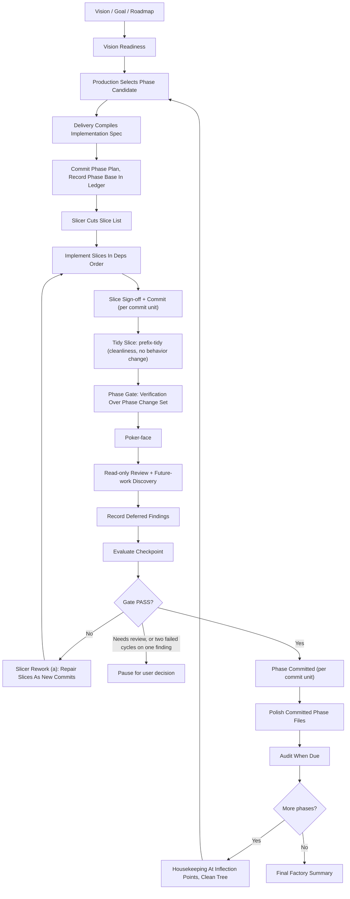

# Loop

Use this reference when the top-level `factory` skill has already selected a phase candidate and you need the detailed execution model.

## Operating Model

Factory runs an iterative implementation loop over a phase set produced by [production](production.md) and compiled by [$delivery](../../delivery/SKILL.md).

It does not flatten unrelated phases into one mega-plan. It should preserve real phase boundaries and only make the next phase executable after the previous phase has been delivered, checked, and committed. It should also avoid artificial long-tail phase splitting: once the implementation pattern is known, execute the remaining homogeneous work as a coherent batch unless a named split boundary requires separation.



The order in the diagram is the same sequence stated in [factory's Order](../SKILL.md#order); change it there first.

## Autonomy And Compaction

Factory should assume it may outlive the current conversational context.

To stay resumable:

- keep the run's one ledger as a file at its default path (see [Ledger File](#ledger-file)), never only in chat
- record the current phase, its phase base, completed phases, pending phases, delivery specs, verification commands, deferred findings, and commit hashes in it
- record slice status in the slice file as each slice moves
- prefer durable repo artifacts over chat-only plans
- after every phase, state the next selected phase or the reason for pausing

Resume from the ledger, the slice file's status lines, and `git log` (the `Slice:` trailers), not from chat history.

## Before Starting

Establish the selected phase candidate and destination surface.

Required inputs:

- the execution-ready goal boundary from [vision](vision.md)
- the production section of the ledger and the selected phase candidate from [production](production.md)
- the target repository or execution environment
- the artifact location for phase delivery specs
- the commit unit (`per-slice` by default; see [factory's Commits](../SKILL.md#commits)); ask, or infer it from repo rules and history
- the intended checkpoint after each phase

If the selected phase candidate is not bounded enough to compile into implementation work, return to production and split it before continuing.

If the user has not supplied an artifact location, use the repo's own convention when one is obvious, otherwise the defaults below. Record the paths used in the ledger.

## Ledger File

State lives in files. Default locations (a repo's own convention wins; record the path used):

| Artifact | Default |
| --- | --- |
| Goal | `GOAL.md` (repo root or the repo's docs dir) |
| Campaign | `CAMPAIGN.md`, or `<name>.campaign.md` |
| Delivery spec | one per phase, in the repo's docs/plans dir, e.g. `docs/plans/<name>.md` |
| Slice list | `<spec-stem>.slices.md` next to the spec, one per phase |
| Ledger | one per run: `<goal-or-campaign-stem>.ledger.md` next to the `GOAL.md` or `CAMPAIGN.md` (a run with neither uses `<spec-stem>.ledger.md` next to the spec) |
| Audit report | `<goal-or-campaign-stem>.audit.md` next to the ledger, or `audits/<base>..<head>.md` for an ad-hoc range |

One delivery spec is one factory phase by default. A multi-phase goal gets one spec and one slice file per phase, and the run keeps one ledger across all of them.

The ledger holds, for the run:

- the commit unit
- the current phase and the next phase
- deferred findings, each with an owner and a done-when
- audit verdicts
- any risk the user accepted by name

And, per phase, an entry with:

- the spec path and the slice-file path
- the phase base (the commit the phase started from)
- the commit unit in force for the phase
- commits (short hash and subject)
- validation evidence, including each `red_first: yes` slice's failing-output summary
- a **Checkpoint** section: gate results, the poker-face verdict or skip reason, evaluator modes, deferred findings with owner and done-when, and failed gates with their cycle count

The ledger and the current slice file are bookkeeping paths ([factory's Commits](../SKILL.md#commits)): they are left out of slice diffs, ride along with the commit that updates them, and gate results are committed as `chore(ledger): <phase> <event>`.

## Factory Intake

Build the ledger file before running the first phase. Commit it, with any plan artifact (goal, campaign, delivery spec, slice file) not already committed, as `docs(plan): <name>` per the commit unit (in `user-commits` mode, staged and reported).

Default ledger fields:

- `Vision Source`
- `Vision Readiness`
- `Production`
- `Delivery Spec Directory`
- `Target Repo`
- `Commit Unit`
- `Slice File`
- `Current Phase Candidate`
- `Current Phase`
- `Phase Base`
- `Completed Phases`
- `Pending Phases`
- `Commits`
- `Validation Evidence`
- `Checkpoint Policy`
- `Agent Policy`
- `Correctness Policy`
- `Review And Future-work Policy`
- `Polish Policy`
- `Deferred Findings / Future Work`
- `Failed Gates`
- `Audit Verdicts`
- `Next Phase`
- `Granularity Policy`
- `Release Checkpoint Policy`
- `Open Questions`

`Slice File`, `Phase Base`, `Commits`, `Validation Evidence`, `Failed Gates`, and the Checkpoint section are kept per phase, in that phase's entry.

## Phase Selection

Work one phase at a time.

Select the next phase using this priority:

1. explicit user instruction
2. selected phase candidate from production
3. first incomplete phase in the goal or campaign
4. next dependency-unblocked phase in the unit graph
5. largest coherent batch that can produce a meaningful checkpoint without crossing a concrete split boundary

Do not skip around the production section of the ledger unless the user asks or a dependency requires it.

Before handing the phase to delivery, make the phase boundary explicit:

- `Phase Name`
- `Phase Goal`
- `Phase Candidate`
- `Phase Base`
- `Inputs`
- `Expected Outputs`
- `Out Of Scope`
- `Checkpoint Target`

## Phase Granularity

Prefer batched, coherent phases.

Phase size is not slice size. [$slicer](../../slicer/SKILL.md) keeps each slice small (by default 5 to 10 minutes of work). A phase is the group of slices whose gate is worth running together. Factory phases should be large enough that the phase gate is worth running and small enough that verification, review, and rework remain honest. The default phase is the largest coherent batch that can pass one meaningful checkpoint.

Default granularity rules:

- choose the largest related phase that still produces a durable, useful outcome
- keep the blast radius small enough that failed work can be repaired without unwinding unrelated decisions
- after one implementation pattern is proven, apply it across the remaining homogeneous requirements in the same phase
- split phases when they mix independent subsystems, migrations, public contracts, UI flows, or deployment concerns
- keep a phase intact when splitting it would destroy the acceptance criteria or force artificial handoffs
- prefer a few substantial phases over a long series of process-heavy micro-phases; commit granularity inside a phase follows the commit unit
- make rollback and rework cost part of phase selection

Long-tail phase splitting is a failure mode. Do not create many near-duplicate phases for remaining requirements that share the same implementation pattern, validation path, and ownership boundary. If the next proposed phase would be mostly delivery-spec text, checkpoint narration, polish/closeout reporting, and only a small implementation delta, batch it with adjacent related work.

Warning signs that a phase is too large:

- it needs several unrelated checkpoint targets
- it changes multiple ownership boundaries at once
- it requires broad speculative refactoring before any user-visible or testable result
- it cannot be explained as one coherent outcome
- a failed phase gate would make it hard to identify the responsible change

Warning signs that a phase is too small:

- it applies an already-established pattern to one file, one variant, one command, one fixture, or one doc section while many equivalent items remain
- it has the same validation command and acceptance shape as adjacent pending work
- its delivery spec, phase gate, polish, and checkpoint overhead dominate the implementation
- completing it would leave a queue of near-identical follow-up phases
- the remaining related work can reasonably finish in the same implementation cycle

When a phase looks too large, revise the phase set before invoking delivery. Delivery should receive a bounded phase, not a whole-program bundle disguised as one phase.

When a phase looks too small, revise the phase set before invoking delivery. Merge it with adjacent homogeneous requirements until the next checkpoint is a substantial completed phase.

## Delivery Handoff

Invoke [$delivery](../../delivery/SKILL.md) for the selected phase candidate.

The handoff should ask delivery for implementation-sized work, not a whole-program factory plan. One delivery spec covers one phase by default.

The delivery artifact must include the sections in [delivery's Artifact list](../../delivery/SKILL.md#artifact), scoped to this phase.

Save the artifact before implementation begins, and commit it as `docs(plan): <name>` when it is written or approved. A small already-specified phase may use the existing issue or goal as its plan instead; the ledger file is still required.

Save the spec in the repo's docs/plans dir (for example `docs/plans/<name>.md`) unless the repository already has a naming convention; then use that.

When the phase needs more than one slice, cut the saved plan with [$slicer](../../slicer/SKILL.md). The slice list goes next to the spec as `<spec-stem>.slices.md`, ends with a `<prefix>-tidy` slice (see [Tidy Slice](#tidy-slice)), and is committed as `docs(plan): <name>`.

## Implementation Loop

After the delivery spec and slice list are saved, implement the selected phase completely.

Factory owns execution, not just planning.

For each phase:

- inspect the live repo state and current diff
- run the slice list per [Running a Slice List](#running-a-slice-list)
- use agents deliberately to preserve factory context and isolate bounded work
- keep edits scoped to the selected phase
- update tests, docs, and migrations required by the phase
- apply established patterns across the full selected batch before the tidy slice
- run the verification commands named in the delivery spec
- run any additional repo-standard hygiene checks discovered during implementation

### Verification scoping

Default verification uses the project's plain test runner unless a measured alternative is faster with identical results. Use the narrowest scope that proves the change, and widen at checkpoints:

- **Inner loop (implementer, slice sign-off, polish):** the touched package, module, or test only. Examples: `cargo test -p <crate> --lib`, `go test ./pkg/...`, `pytest path/to/test_file.py::test_name`, `npm test -- path/to/file`.
- **Phase checkpoint:** every package the phase touched, unit and integration tests.
- **Release gate audit:** the full suite. A full-repository or full-workspace run is a release-gate or audit activity, not an inner-loop default.

A bare whole-repository run (for example `cargo test` with no `-p` in a large workspace) can take minutes, so reserve it for checkpoints where the wider scope is worth it.

If implementation reveals that the delivery spec is materially wrong, update the delivery artifact with a short revision note before continuing.
If implementation reveals that the delivery spec is artificially granular, merge the remaining homogeneous work into the active phase, update the delivery artifact with the batching revision, and continue instead of cycling through micro-phases.

## Running a Slice List

Run the slice list that [$slicer](../../slicer/SKILL.md) saved for the phase.

- Execute slices in `deps` order. A slice's `deps` wait for **landed**, not committed. Slices with disjoint write scopes may run in parallel when the harness supports subagents; otherwise run them one at a time.
- Give the implementer only the slice brief, plus the project's own instructions.
- Reject any slice diff outside the slice's `write_scope`. The slice goes back to its implementer, or becomes a `blocked-scope` report.
- A `blocked-scope` report goes to slicer rework mode (b). A follow-up the implementer found outside its slice goes to slicer rework mode (c).
- **Split trigger:** when an attempt fails sign-off twice, or the implementer reports that the slice is larger than its brief, send it to slicer split mode.

The **slice diff** is the set of paths changed since the last slice commit (or since the phase base), minus the bookkeeping paths ([factory's Commits](../SKILL.md#commits)). In `per-phase` and `user-commits` modes, factory stages each signed-off slice's paths, so the next slice diff is the unstaged change set minus bookkeeping paths. When slices run in parallel, their combined diff must split cleanly into their write scopes.

### Per-slice steps

For each slice:

1. Set its status to `in-progress`.
2. Give the implementer the slice brief.
3. When the brief says `red_first: yes` (new behavior or a bug fix): write the test, run it, confirm it fails for the stated reason (the missing behavior or the bug, not a typo or broken setup), and record a summary of the failing output in the phase's ledger entry. Only then implement.
4. Implement within `write_scope`.
5. Run slice sign-off. A failure goes back to the implementer; the second failure is the split trigger.
6. Record the slice as landed in the slice file and the ledger, then commit or stage per the commit unit.

### Slice sign-off

A slice is signed off when:

1. its slice diff touches only files in its `write_scope` (bookkeeping paths excluded);
2. the formatter, the linter, and the narrow check named in its brief pass, run on the `write_scope` files;
3. the brief's test exists and passes, and when the brief says `red_first: yes`, the ledger records it failing for the stated reason before the change; or the brief states why there is no test and the existing tests covering the `write_scope` pass;
4. a read-only correctness read of the slice diff finds no `CRITICAL` or `HIGH` (≈ `P0` / `P1`) issue.

The correctness read makes no edits. A `CRITICAL` or `HIGH` finding sends the slice back to its implementer; `MEDIUM` and `LOW` findings go to the ledger as notes. The correctness skill's update mode is for correctness-mode phases, not for sign-off.

A slice is **landed** when it is signed off and recorded in the slice file. Committed is separate:

- `per-slice`: commit the slice at once. The commit holds the slice's `write_scope` plus the bookkeeping paths it updated (its status line and ledger entry). Its message is `<type>(<scope>): <slice title>` with a trailer `Slice: <id>`. A commit cannot name its own hash, so the status line goes in as `landed (uncommitted)` and the short hash is written in right after; that edit rides along with the next commit. The `Slice:` trailers in `git log` are the authority when the two disagree.
- `per-phase`: stage the slice's paths and set its status to `landed (uncommitted)`. The phase commits once, after the gate passes.
- `user-commits`: stage the slice's paths, set its status to `landed (uncommitted)`, and report it. The user commits when they choose.

### Slice status

Record each slice's status in the slice file, one status line per slice, and in the ledger:

```text
- status: pending | in-progress | landed <short hash> | landed (uncommitted) | blocked-scope | split into <ids> | reworked by <ids>
```

Repair, rework, and split slices are appended as a new cut in the same slice file; never rewrite landed slices or landed commits.

## Agent Policy

When the user explicitly asks to execute, invoke, or use `$factory`, that request is explicit authorization for factory to use subagents according to this Agent Policy unless the user says otherwise. Factory does not need to ask again before launching bounded subagents that fit the policy. Subagents are an optional harness feature; without them, factory runs the same work itself, one slice at a time.

Default subagent authorization covers:

- read-only explorer agents for bounded context gathering
- read-only review and future-work discovery agents for deferred findings and future-work options
- bounded implementation workers, one per slice; parallel workers only on disjoint write scopes from a slicer slice list, otherwise one worker at a time
- parallel read-only agents only when their domains are independent

Factory remains responsible for supervision, diff review, integration, validation, checkpoint evaluation, and commits. Subagents provide bounded work products; they do not own the factory run.

Factory should encourage agent use where it improves autonomy and preserves the factory's own context.

Use read-only explorer agents liberally for bounded context collection, especially when:

- mapping unfamiliar repository structure
- identifying test commands, build commands, or CI conventions
- tracing call paths or ownership boundaries
- checking whether a phase touches shared contracts
- gathering evidence for checkpoint evaluation

Explorer agents should return concise findings with file paths, commands, and risks. Factory should trust but sanity check their output against the live repo before acting on high-risk conclusions.

Use implementation agents only when the edit work is bounded.

Implementation-agent rules:

- default to one implementation agent at a time; run several in parallel only when a slicer slice list gives each a disjoint write scope
- give each agent its slice brief and write scope
- tell the agent it is not alone in the codebase and must not revert unrelated changes
- require the agent to list changed files and verification run
- review the diff before accepting the work
- integrate, repair, or reject the work from the factory supervisor context

Do not split edit ownership across multiple implementation agents unless their write scopes are disjoint, as cut by a slicer slice list. Serialize git writes: workers do not commit, and factory stages and commits path-limited. Factory remains responsible for integration and final sanity checks.

## Tidy Slice

In-phase structural cleanup is a final **tidy slice**, not housekeeping. [$slicer](../../slicer/SKILL.md) ends every phase cut with `<prefix>-tidy`: it depends on every other slice in the phase, its brief says `red_first: no`, and its `write_scope` is the files the phase changes (the union of the other slices' write scopes) plus new files under the same directories (for helper extraction). Factory runs it like any slice, last: signed off and committed per the commit unit. Slicer leaves it out only for a phase that changes no source files (a docs-only phase), with the reason in the cut's notes.

The tidy slice applies the [$cleanliness](../../cleanliness/SKILL.md) lens and never changes behavior. A behavior change it finds is a finding for slicer rework, not an edit in the tidy slice. Use it to keep LLM-generated code from accumulating giant functions, mixed ownership boundaries, heavy closures, long inconsistent names, comment gaps, oversized files, and dispatch sprawl.

Default scope:

- code changed by the current phase
- immediate local modules needed to preserve coherent boundaries
- tests only when test shape is part of the phase's maintainability risk

The tidy slice may perform behavior-preserving reshaping and mechanical cleanup:

- split a changed file along an existing repo boundary
- extract helpers with clear domain names
- move logic out of routes, facades, closures, or dispatch arms
- add module boundary comments and short `WHY` comments
- rename phase-introduced symbols for clearer local families
- replace repeated generated patterns with a small table or policy object when that matches repo style
- apply formatting or repo-standard mechanical cleanup
- remove dead code, debug residue, unused imports, stale comments, and duplication introduced by the phase

The tidy slice must not:

- change public behavior
- broaden into unrelated pre-existing architecture debt
- perform aesthetic-only churn
- remove compatibility paths or deprecated aliases (a separate removal pass owns that)
- treat every long function as phase-blocking when the phase did not touch it

If the tidy slice finds structural debt outside the active phase, record it under `Deferred Findings / Future Work` with `Type: cleanliness` unless it blocks the current checkpoint. When the tidy slice finds nothing worth changing, it signs off with no diff; record that and the reason in the phase's Checkpoint.

## Phase Gate

The phase gate runs over the **phase change set**, after every slice (including the tidy slice) has landed: verification → poker-face → review → checkpoint.

The **phase base** is the commit the phase started from, recorded in the ledger when the phase is selected. The phase change set is everything since that base: the commit range `<base>..HEAD` in `per-slice` mode, or the commits plus the working-tree diff against the base in `per-phase` and `user-commits` modes.

### Verification

Run the phase checkpoint verification over the change set (see [Verification scoping](#verification-scoping)). Record commands and results in the phase's Checkpoint in the ledger.

### Poker-face

Run [$poker-face](../../poker-face/SKILL.md) whenever a goal, spec, or acceptance criteria exist. Skip it only when none exist, and record the reason. Without delegation, run a self-contained cold pass and report `Evaluator mode: self-contained cold pass`. "Delegation unavailable" is not a skip reason. Map its verdict per [factory's Verdicts and Severity](../SKILL.md#verdicts-and-severity).

Which misses block, and when a `MEDIUM` miss may be deferred, is set in [factory's Verdicts and Severity](../SKILL.md#verdicts-and-severity). Surface any `MEDIUM` deferral to the user before the gate passes. Blocking misses go to slicer rework mode (a).

### Review And Future-work Discovery

Run a read-only review and future-work discovery pass after verification and poker-face. This pass is mandatory, but it is discovery-only: do not edit during the pass, and do not silently expand the active phase to fix newly noticed work.

The pass should inspect the changed files, adjacent code, relevant docs, and validation evidence. It should combine a conventional code-review lens with a local-readability lens (does the code read well in place?), looking for:

- sloppy or fragile implementation details introduced by the phase
- cleanup, refactoring, or deduplication opportunities made visible by the new implementation
- files, modules, functions, tests, or docs that now exceed repo-defined size or complexity metrics; if no metric exists, label the call as a heuristic
- missing or stale technical documentation, examples, migration notes, or operator guidance
- test, lint, formatting, observability, or validation gaps not already covered by the phase
- bugs or behavioral risks discovered during the phase that are real but not required for the current checkpoint

Classify every finding as either phase-blocking or deferred:

- `phase-blocking`: required to satisfy the selected phase, acceptance criteria, verification, or checkpoint; it fails the gate and goes to slicer rework mode (a) as repair slices
- `deferred`: valid future work that is out of scope for the selected phase; record it in the ledger and keep the phase boundary intact

Deferred findings must be recorded under `Deferred Findings / Future Work` with:

- `Type`: `bug`, `duplication`, `refactor`, `future-work`, `cleanliness`, `size-metric`, `docs`, `test-gap`, `validation-gap`, or `other`
- `Evidence`: concrete files, symbols, commands, observed behavior, or metrics
- `Why Deferred`: why it is not part of the current phase
- `Suggested Handling`: add a phase to this factory run, create a new factory plan, file an issue, investigate later, or ignore with rationale
- `Owner` and `Done-when`: who handles it and the observable state that closes it
- `Priority`: `blocking-later`, `important`, or `opportunistic`; [factory's Verdicts and Severity](../SKILL.md#verdicts-and-severity) says how auditor, correctness, and poker-face severities map to these; an independent-review item is always `blocking-later` for release gates and closeout

Surface deferred findings to the user after the phase checkpoint and in the final factory summary. Give the user clear options to add follow-up phases to the current factory run or capture the findings as a separate factory plan. If there are no deferred findings, say so explicitly.

### Checkpoint

Evaluate the checkpoint named in the delivery spec, and write the result into the phase's **Checkpoint** section in the ledger ([Ledger File](#ledger-file)). Commit it as `chore(ledger): <phase> <event>` (in `user-commits` mode, staged and reported).

Default checkpoint fields:

- `Delivered Outputs`
- `Slices Landed`
- `Tidy Slice`
- `Correctness (slice sign-off reads)`
- `Verification Run`
- `Poker-face` (verdict, or skip reason)
- `Evaluator Modes`
- `Read-only Review And Future-work Discovery`
- `Deferred Findings / Future Work`
- `Gate Result`
- `Failed Gates And Cycle Count`
- `Residual Risks`
- `Spec Revisions`
- `Release / Version Decision`
- `User Decisions Needed`
- `Next Phase Readiness`

Gate results are:

- `PASS`
- `FAIL`
- `NEEDS FURTHER REVIEW`

Only continue to the next phase when the gate passes or the user explicitly overrides.

If the gate fails, record the failure and its cycle count in the ledger and fix forward. Findings from poker-face, review, or correctness at the gate, and failing check output, go to slicer rework mode (a). The repair slices run through slice sign-off and land as new commits; then rerun the affected parts of the gate (verification, poker-face, review) over the phase change set, which now includes the repairs. After two failed gate cycles on the same finding, the gate returns `NEEDS FURTHER REVIEW` and factory pauses for the user. Never rewrite landed commits. Never `reset --hard`, `checkout -- .`, `restore` over others' work, `clean`, `stash`, `rebase`, amend a landed commit, or force-push; never discard changes you did not make. Do not mark a failed phase complete.

If the gate needs further review, pause and surface the decision clearly.

## Commits

Every phase ends with its work committed per the commit unit, before polish runs. Landed and committed are separate (see [Running a Slice List](#running-a-slice-list)).

- `per-slice`: each slice commits at its sign-off, and the phase gate is evaluated over `<base>..HEAD`.
- `per-phase`: the phase makes one commit when the gate passes, holding the phase change set and its bookkeeping. A following `chore(ledger)` commit then updates each `landed (uncommitted)` status to `landed <short hash>`, since a commit cannot name its own hash.
- `user-commits`: factory has staged each signed-off slice and reported it; the user commits when they choose. Polish waits until the user has committed the phase.

The phase is complete, and `per-phase` mode makes its commit, only after:

- the phase plan is saved (the delivery artifact, or the existing issue or goal for a small already-specified phase) and the ledger file is current
- every slice in the phase is landed, or recorded as split or reworked by slices that landed
- the tidy slice has landed, or the cut left it out for a docs-only phase with the reason in its notes
- verification has run over the phase change set or any skipped checks are documented
- poker-face cleared, or was skipped with a recorded reason (only when no goal, spec, or acceptance criteria exist)
- read-only review and future-work discovery has run, with deferred findings recorded or an explicit none found
- checkpoint evaluation passes or is explicitly overridden
- each commit is limited to its slice's write scope plus the bookkeeping paths it updated (`per-slice`), or the staged diff is limited to the phase change set and its bookkeeping (`per-phase`)

Default commit message shapes:

```text
<type>(<scope>): <slice title>

Slice: <id>
```

For a `per-phase` commit:

```text
Complete <phase name>
```

For bookkeeping commits ([factory's Commits](../SKILL.md#commits)):

```text
docs(plan): <name>
chore(ledger): <phase> <event>
docs(audit): <range>
```

If the repository has a stronger commit convention, follow it, and keep the `Slice:` trailer so a resumed run can read it.

Never mix multiple completed phases into one commit unless the user explicitly requests it.

## Polish

Run [$polish](../../polish/SKILL.md) after the phase gate passes and the phase's work is committed. Polish runs on committed work only. It is the factory lifecycle's second-pass file-level review and cleanup loop, and its own per-file commits contain only polish.

Polish must cover the phase-modified primary source files derived from the phase change set and the ledger. In `user-commits` mode polish runs only after the user has committed the phase; it then stages one file at a time and reports, and the user commits. Exclude generated, vendored, lock, build, cache, fixture-only, and third-party files unless they were intentionally changed as primary phase work.

Polish result handling:

- a bug, or an unresolved correctness, cleanliness, validation, or boundary issue: stop work on that file and record the finding. Route it to slicer rework mode (a) as repair slices; they run through slice sign-off and land as new commits, then rerun the affected gate parts (verification, review, poker-face) and polish for the affected file. Polish commits stay polish-only.
- no useful change for a file: record it as inspected with no change and continue
- polish creates per-file commits: record those commits in the ledger and final report
- polish makes no commits: continue only after recording the inspected file list and validation status

Do not use polish to broaden the active phase into unrelated cleanup. If polish reveals valid future work outside the phase boundary, record it under `Deferred Findings / Future Work`.

After polish, run an audit when one is due and resolve it per [factory's After Audit](../SKILL.md#after-audit).

## Housekeeping Between Phases

[$housekeeping](../../housekeeping/SKILL.md) is not an in-phase step. It runs only between phases, at inflection points, or at goal or campaign closeout, on a clean tree, where its pull and its own commits are safe. Do not run it with uncommitted phase work in the tree.

## Release And Version Checkpoints

After a completed phase is committed, make a release/version decision before continuing to the next phase.

Default release checkpoint questions:

- did this phase change user-visible behavior, CLI output, public APIs, schemas, data migrations, config, deployment shape, operator docs, or compatibility expectations?
- has the current run accumulated several completed checkpoints since the last version bump or release?
- does the repo have a known release convention such as semver, package metadata, changelog, tags, release notes, Homebrew formulas, deploy manifests, or migration ledgers?
- would releasing now reduce risk, make rollback easier, or keep users/operators from receiving a large surprise bundle later?

Release decisions:

- `release-now`: add or execute a release/version phase, following the repo's release convention and any explicit user authorization gates
- `release-prep`: update version metadata, changelog, release notes, or migration docs, but stop before external publication if authorization is required
- `defer-release`: continue without release work, recording the reason and the next checkpoint where release should be reconsidered
- `not-applicable`: no user-visible, package, deployment, or operator-facing release surface was found

Do not perform external publication, production deployment, package registry pushes, DNS changes, payment changes, or destructive migrations merely because a release checkpoint says `release-now`. Treat those as stop conditions unless the user, campaign, or repo policy has already authorized them.

## Iteration Control

After a phase is committed, polished, and audited when due, choose the next action:

- add or execute a release/version phase when the release checkpoint says `release-now`
- run housekeeping when this is an inflection point and the tree is clean
- continue to the next phase when the phase set is clear and unblocked
- merge adjacent pending phases when the completed phase established a pattern that applies to them
- add a follow-up phase when the user chooses to promote deferred findings into the active factory run
- capture deferred findings as a separate factory plan when they are coherent but outside the active run
- revise the phase list when implementation changed the dependency graph
- pause when the next phase needs a user decision
- stop when all phases are complete

When continuing, start again at `Phase Selection`. Do not reuse a stale delivery spec for the next phase: each phase gets its own spec, slice file, and phase base, and the run keeps its one ledger.
